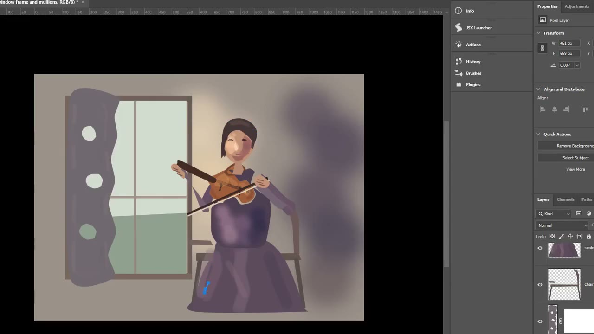

# Демонстрации PaintPilot — реальное рисование в Photoshop

## Скрипачка возле окна — минутный ролик для Reddit

[](../assets/showcase/paintpilot-reddit-violinist-60s.mp4)

**[Открыть или скачать MP4](../assets/showcase/paintpilot-reddit-violinist-60s.mp4)** — 59,633 секунды, 1280 × 720, 30 кадров/с, H.264, без звука.

Это смонтированная по хронологии **запись настоящих действий агента в Photoshop**: фигура скрипачки, скрипка, окружение, освещение и последующие уточнения. Ролик не создан видеогенератором и не является непрерывной записью в реальном времени или доказательством художественного качества всей работы.

### Как мы его получили

PaintPilot сначала сохранял короткие видеозаписи выполняемых операций вместе с текстовыми комментариями. Штатный скрипт [`build-process-video.mjs`](../scripts/dev/build-process-video.mjs) ([инструкция](../scripts/dev/README-build-process-video.md)) составил из них полную запись `process-video.mp4` продолжительностью **913,6 секунды** (15 минут 13,6 секунды). При сборке длинного видео исходные фрагменты были замедлены в 4 раза, а для комментариев подготовлен отдельный `.srt`.

Затем **собственный Python-скрипт с FFmpeg** выбрал из длинного видео десять хронологических эпизодов:

`0–28`, `56–91`, `114–134`, `176–196`, `212–232`, `266–282`, `520–540`, `597–627`, `669–691`, `722–745` секунд.

Каждый эпизод был ускорен в 4 раза относительно длинного видео (`setpts=(PTS-STARTPTS)/4`), приведён к 30 кадрам/с, обрезан до рабочей области Photoshop (`crop=1440:810:170:80`) и масштабирован до 1280 × 720 фильтром Lanczos. Кодирование — H.264, `libx264`, CRF 20. В конце добавлен примерно секундный стоп-кадр, извлечённый из длинной записи около отметки 903 секунды. Одиннадцать частей объединены без повторного кодирования.

Сохранился [оригинальный скрипт монтажа](../scripts/dev/build-reddit-violinist-demo.py). Для повторения нужна исходная запись `processes/window-violinist-process/study-01/export/final/process-video.mp4` (локальная папка `processes/` игнорируется Git), Python и FFmpeg. Из корня репозитория:

```bash
python scripts/dev/build-reddit-violinist-demo.py
```

Скрипт работает в локальных игнорируемых каталогах и не перезаписывает размещённую здесь публичную копию видео. **Видео показывает процесс работы агента с Photoshop**, а не является полной приёмкой Guard, качества картины или релизной готовности.
